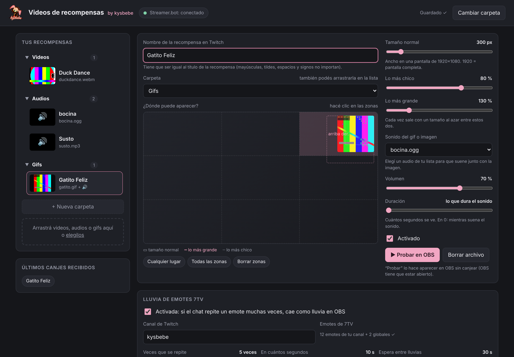

  

<h1 align="center">Videos de recompensas para OBS</h1>

por <a href="https://github.com/kysbebe"><b>kysbebe</b></a>

Cuando alguien canjea una recompensa de **puntos de canal en Twitch**, aparece su **video, gif o audio** en **un lugar y con un tamaño al azar** de la pantalla. Y si el chat spamea un **emote de 7TV**, cae como **lluvia** en pantalla. Además muestra **alertas** de seguidores, subs, bits, raids y donaciones con tu propio estilo. Todo funciona con **una sola fuente de OBS**, y se configura desde un **panel visual**, sin programar.

## Qué hace

- 🔔 **Alertas** *(nuevo en v3)*: seguidor, sub, resub, sub regalada, varias regaladas, bits, raid y donación. Arrancan con un estilo limpio y cada quien elige letra, colores, posición, animación, y un gif, video o sonido, texto, duración y mínimo por alerta. Salen de a una y las recompensas esperan su turno.
- 🎬 **Un video, gif o audio por recompensa:** "Duck Dance" → `videos/duckdance.mp4`. Mayúsculas, tildes y espacios no importan.
- 🔊 **Audios y gifs con sonido** *(nuevo en v2)*: `.mp3`, `.ogg`, `.wav`, `.gif`, `.png`, `.webp`. Un gif puede tener su propio sonido.
- ⏱️ **Volumen y duración por recompensa** *(nuevo en v2)*: cortá un audio o video a los segundos que quieras, o elegí cuánto se ve un gif.
- 📁 **Carpetas en el panel** *(nuevo en v2)*: Videos, Audios, Gifs y las que crees vos. Arrastrás cada recompensa a la que quieras.
- 🗣️ **Lectura en voz (!tts)** *(nuevo en v2)*: el chat escribe `!tts hola` y se escucha en el stream. Elegís quién puede usarlo, espera por persona, largo máximo, voz y velocidad. 12 voces (acentos de español, inglés, portugués y más) y efectos ardilla y monstruo: el chat los elige con `!tts uk hello` o `!tts ardilla hola`. También funciona con una recompensa que pida texto.
- 🌧️ **Lluvia de emotes 7TV** *(nuevo en v2)*: si muchos mandan el mismo emote en pocos segundos, llueve en pantalla. Cuántas veces, en cuántos segundos y la espera entre lluvias se eligen en el panel.
- 🎲 **Lugar y tamaño al azar:** elegís en qué zonas de la pantalla puede salir (arriba a la izquierda, centro, abajo a la derecha…) y entre qué tamaños.
- 🖱️ **Panel visual (`configurar.html`):** arrastrás archivos, elegís zonas en una pantallita, ajustás tamaño, volumen y duración, y probás en OBS con un botón (también la lluvia). Todo se guarda solo.
- 🟩 **Quita el fondo verde** de videos de pantalla verde.
- El sonido entra al **mezclador de OBS**.
- 🛡️ **Anti-spam:** máximo de recompensas a la vez y **máximo en espera** *(nuevo en v2)*; lo que llega con la fila llena se descarta.
- ⚡ OBS toma los cambios del panel en 2 segundos, sin actualizar la fuente.

## Qué necesitás

- Windows y **OBS Studio 28 o más nuevo** → [obsproject.com/download](https://obsproject.com/download)
- **Streamer.bot** (gratis) → [streamer.bot/downloads](https://streamer.bot/downloads)
- Un canal de Twitch con **puntos de canal** (afiliado o partner)
- Para la lluvia: tus emotes en [7tv.app](https://7tv.app)
- **Chrome** o **Edge** para abrir el panel

## Instalación

📄 **La guía completa paso a paso, con capturas, está en [docs/Guia-videos-de-recompensas.pdf](docs/Guia-videos-de-recompensas.pdf).**

Resumen:

1. **Descargá este repositorio:** botón verde **Code › Download ZIP**, y extraelo en una carpeta fija.
2. **Streamer.bot:** conectá tu cuenta **Broadcaster** de Twitch (Platforms › Twitch › Accounts).
3. **Streamer.bot › Servers/Clients › WebSocket Server:** Auto Start **On**, `127.0.0.1`, puerto **8080**, Authentication **desmarcado**, **Start Server**.
4. **OBS › Herramientas › Ajustes del servidor WebSocket:** que el puerto sea **4455** (nunca 8080) y Enable Authentication desmarcado.
5. **OBS › Fuentes › + › Navegador:** Archivo local = `widget.html`, **1920 × 1080**, marcá **Controlar audio mediante OBS**. Para escucharlo vos, activá los auriculares de la fuente en el mezclador.
6. Abrí **`configurar.html`** con Chrome o Edge, elegí esta carpeta y agregá tus videos, audios o gifs. La lluvia de emotes toma tu canal sola desde Streamer.bot.

## Problemas comunes

| Qué pasa | Qué hacer |
|---|---|
| El widget se ve vacío | Es normal: es transparente. Probá con **▶ Probar en OBS**. |
| "Sin conexión con Streamer.bot" | WebSocket Server de Streamer.bot en **Running**, puerto 8080. El de OBS en **4455**. |
| Conectado pero no pasa nada al canjear | La cuenta **Broadcaster** tiene que estar conectada en Streamer.bot. |
| "No hay archivo para…" | Asigná la recompensa en el panel desde **Últimos canjes recibidos**. |
| No llueve | En el panel, "Emotes de 7TV" tiene que decir cuántos emotes encontró. Si no, revisá el **Canal de Twitch**. |
| No sale ninguna alerta | Probá con **▶ Probar en OBS** en la sección Alertas. Las donaciones necesitan tu cuenta conectada en Streamer.bot › **Integrations**. |
| El video no se ve | Puede estar en HEVC/H.265: convertilo a H.264. |

Más en la [guía en PDF](docs/Guia-videos-de-recompensas.pdf).

## Seguridad y privacidad

- Las recompensas funcionan **en tu PC**: el widget se conecta a Streamer.bot en tu propia computadora.
- La lluvia de emotes **solo lee** el chat público de tu canal con una conexión anónima de Twitch (sin cuenta ni contraseña) y baja la lista de emotes de la API pública de 7TV. No envía nada tuyo. Si desactivás la lluvia y el TTS, no se conecta a ninguno de los dos.
- El TTS manda el texto a leer a la voz pública de Google Translate (`translate.google.com`), sin cuenta.
- `config.js` se lee como **datos**, no se ejecuta como código en el panel, y el widget valida todos los valores (tamaños, volumen, nombres de archivo) antes de usarlos.
- Las alertas llegan desde Streamer.bot en tu PC. Si elegís una letra de Google Fonts, se baja de `fonts.googleapis.com`; las letras del sistema no usan internet.
- El widget **solo** abre archivos de las carpetas `videos/` y `alertas/`: no acepta rutas a otras carpetas. Las imágenes de emotes solo se cargan desde `cdn.7tv.app` (y `static-cdn.jtvnw.net` si activás los emotes de Twitch).
- Las páginas tienen una **política de seguridad de contenido (CSP)** que bloquea scripts externos y solo permite conectarse a esos sitios.

## Licencia

**Uso personal gratuito. Prohibido vender, redistribuir versiones modificadas, quitar la firma o usar este material para entrenar IA.** Leé las condiciones completas en [LICENSE.md](LICENSE.md).

---

Hecho por <a href="https://github.com/kysbebe"><b>kysbebe</b></a> 🐰

